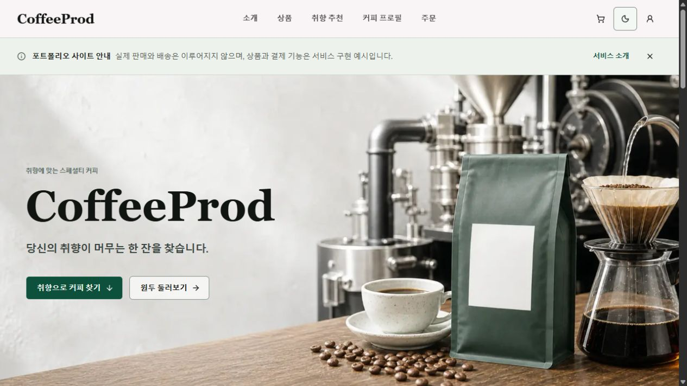
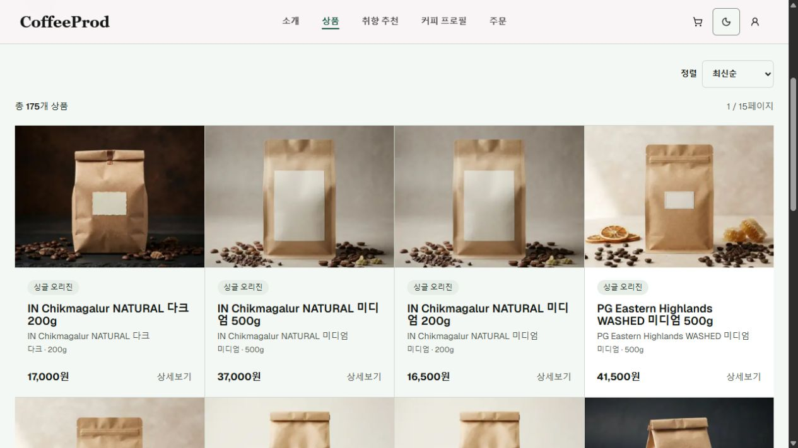
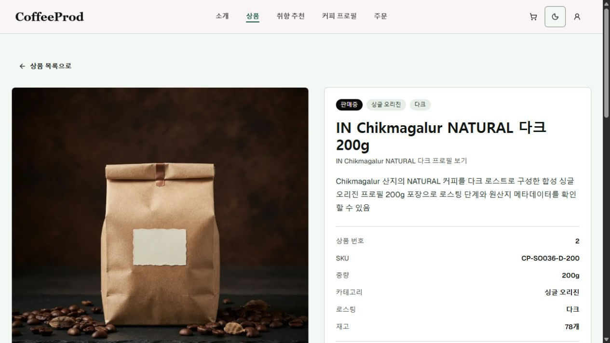
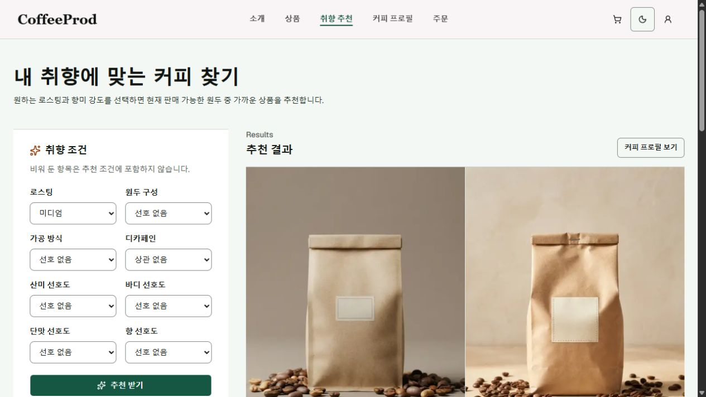

# CoffeeProd Frontend

CoffeeProd는 커피 상품 탐색, 취향 기반 추천, 장바구니와 주문·결제 흐름을 구현한 커머스 포트폴리오 프로젝트다. 이 저장소는 사용자 화면과 관리자 화면을 구성하는 프론트엔드를 담고 있으며, 상품·회원·주문 등의 데이터는 백엔드 REST API와 연동한다.

실제 판매와 배송은 이루어지지 않으며, 상품과 결제 기능은 서비스 구현 예시다.

## 관련 링크

- [사이트](https://coffeeprod.ttagyulab.com/)
- [백엔드 저장소](https://github.com/NewplayerKOR/CoffeeProd)

## 주요 화면과 기능

상품을 둘러보고 커피 정보를 비교하거나, 원하는 취향 조건에서 출발해 추천 상품을 찾을 수 있다. 선택한 상품은 장바구니와 주문·결제 흐름으로 이어진다.

아래는 공개 사이트에서 캡처한 화면이다. 이미지를 누르면 원본 크기로 확인할 수 있다. (2026-11-16 기준)

| 메인 | 상품 목록 |
| :--- | :--- |
|  |  |
| **서비스 진입과 탐색** 상품 목록과 취향 추천으로 이동한다. 메인 아래에는 산미·바디·단맛·향을 입력하는 취향 찾기, 추천 원두 슬라이드와 최근 등록 상품을 배치했다. | **조건에 맞는 원두 비교** 상품명 검색, 카테고리·가공 방식·원두 유형·디카페인·로스팅 필터와 정렬을 제공한다. 상품 카드에서 원두 정보와 중량·가격을 비교하고 상세 화면으로 이동한다. |
| **상품 상세** | **취향 추천** |
|  |  |
| **상품 정보 확인과 구매 옵션 선택** 이미지, 가격, 재고, 로스팅과 커피 프로필을 확인한다. 분쇄 옵션·수량 선택과 장바구니 담기를 제공하며, 리뷰·상품 문의·배송 정보는 탭으로 나눴다. | **선호 조건에서 상품 찾기** 로스팅, 원두 구성, 가공 방식과 향미 강도를 입력한다. 추천 결과에 상품 정보·점수·추천 이유를 표시한다. 캡처는 미디엄 로스팅을 선택한 예시다. |

### 그 외 화면

| 구분 | 내용 |
| --- | --- |
| 커피 프로필 | 원산지·가공 방식·향미·추출법 등 커피 정보와 연결된 상품 조회 |
| 회원과 마이페이지 | 회원가입·로그인, 회원 정보·배송지·커피 취향 관리 |
| 장바구니와 주문·결제 | 장바구니 관리, 주문서 작성, 결제 진행과 성공·실패 안내, 주문 내역·상세 조회 |
| 관리자 | 상품·카테고리·커피 카탈로그·회원·주문·상품 문의 관리, 매출 통계 조회 |

## 기술 스택

| 분류 | 기술 | 사용 범위 |
| --- | --- | --- |
| 프레임워크 |  | App Router 기반 라우팅과 페이지 구성 |
| UI |  | 취향 입력, 상품 필터, 구매 옵션 등 사용자 상호작용 |
| 언어 |  | 컴포넌트 Props, API 요청·응답과 도메인 데이터 타입 정의 |
| 스타일 |  | 레이아웃, 반응형 화면과 테마 스타일 |
| 컴포넌트 |  | UI 컴포넌트의 기반 요소 |
| 아이콘 |  | 메뉴, 버튼과 상태 안내 아이콘 |

상품·커피 정보와 취향 추천, 회원·장바구니·주문·결제·관리자 기능은 백엔드 REST API와 연동한다. 프론트엔드는 요청 결과를 화면에 표시하고, 입력과 처리 상태를 관리한다.

기술 배지: Shields.io · 로고: Simple Icons
